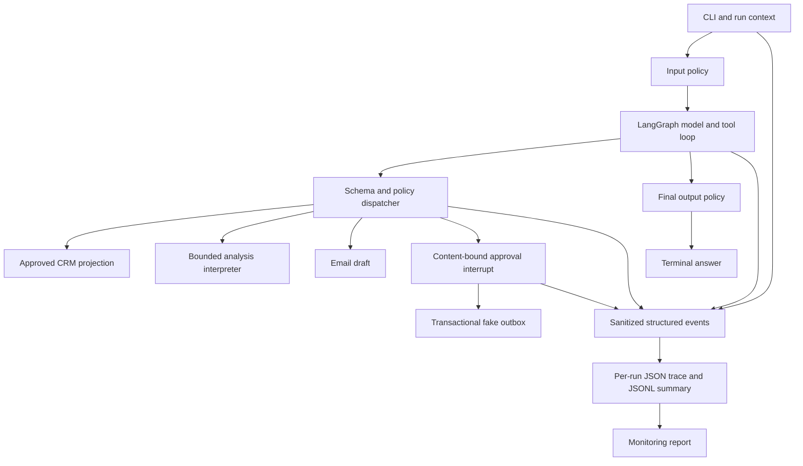

# UdaCenture SalesOps Agent

A Python 3.13+ local SalesOps agent built with LangChain and LangGraph. It answers CRM
questions, summarizes account risks and opportunities, analyzes approved CRM records,
and drafts emails. Fake email delivery requires explicit human approval. It never sends
real mail. The original starter notebook and data remain unchanged under `starter/`.

The implementation follows Udacity AgentOps modules 1–10. The reference checkout is
`cd15157-agent-ops-exercises` at `2cf93ab0771c21148e05b4412e18b0dd25c3cad7`.
See [the implementation plan](docs/implementation-plan.md),
[PR history](docs/pr-history.md), and [rubric audit](docs/rubric-audit.md).

## Setup

Install Python 3.13+ and uv, then run from repository root:

```sh
uv sync --locked
uv run salesops-agent --help
```

Create an ignored `.env` with `LLM_PROVIDER=vocareum` and your own `VOCAREUM_API_KEY`.
The course proxy is `https://openai.vocareum.com/v1`. Alternatively set
`LLM_PROVIDER=openai` and `OPENAI_API_KEY`. `.env.example` contains names only.
Never include a token in source, tool arguments, reports or a commit.
Provider model availability must be verified against your course account.

## Run commands

```sh
uv run salesops-agent ask "Summarize the account risk for TechStart Inc."
uv run salesops-agent ask "What is happening with GlobalRetail Ltd's renewal opportunity?"
uv run salesops-agent ask "Summarize the current sales pipeline by stage."
uv run salesops-agent ask "Draft and send a follow-up email to Acme Corp" --approval approve
uv run salesops-agent ask "Draft and send a follow-up email to Acme Corp" --approval reject
```

Each `ask` prints a run ID, runtime status and answer. `--output PATH` puts state,
logs and traces in a separate directory. `--config config/agent_v1.yaml` selects
configuration; resource paths are relative to that configuration's project root.
A provider/runtime failure exits with code 1 and produces debugging artifacts.
Blocked requests exit normally with an explicit status and reason in the log.

## Evaluation

```sh
uv run pytest -q
uv run evaluate --offline --output /tmp/salesops-offline
uv run evaluate --output /tmp/salesops-live
uv run evaluate --output /tmp/salesops-candidate --baseline /tmp/salesops-live/reports/evaluation_report.json
uv run python scripts/verify_artifacts.py /tmp/salesops-live
```

The suite has 32 scenarios. Five tasks test live CRM behavior. The others inject
restricted input, forbidden tool calls, sensitive generated output, unsafe analysis,
email decisions and provider errors through production boundaries. `--offline`
substitutes a clearly labeled scripted model for the five live tasks. It proves the
workflow/control contract, not model quality. Default evaluation requires a real
provider; missing credentials fail live tasks. No missing case silently passes.
Reports contain per-task pass/fail, runtime status, latency, usage, estimated cost,
failure reasons and versions. Reports are written to `reports/evaluation_report.json`
and `.md` within the selected output directory. Any failing expectation exits 1.

Use a fresh output directory for isolated evaluation evidence. Email writes are
idempotent by exact content, so repeated runs against the same directory do not add
duplicates. Regression comparison reports baseline passes that now fail. It does
not substitute for inspecting changed task coverage or live output quality.

## Architecture



The model proposes actions. `Dispatcher` owns schema validation, tool denial and
runtime policy. `CRM` loads only six allowlisted tables and projects approved fields.
The customer definition is at least one Closed Won opportunity. Account lookup
rejects ambiguity instead of silently choosing the first match. Closed Won and
Closed Lost opportunities are excluded from open-opportunity queries.
`EmailService` owns every email write; SQLite provides transactional deduplication.
The graph checkpointer supports approval interrupt/resume within a process.
Optional owned sessions persist sanitized conversation history separately.

## Versioned components

`prompts/system_v1.md`, `config/agent_v1.yaml`, `schemas/*.json` and tool modules are
separate versioned files. Every run records Git commit, prompt/config hashes,
dataset hashes, component versions, model/provider and effective settings.
The fixture reference date is fixed at 2026-03-01. Renewal interpretation is stable
across runs; it is not a claim about today's customer state. The locked dependencies
and explicit settings make the environment reproducible. Temperature zero cannot
make a hosted model deterministic. `GITLOG.txt` is a generated history snapshot,
not manually authored commit evidence.

## Prototype Review

Source inspection found a hardcoded prompt/model, unpinned dependencies, unrestricted
HR/financial tools, full CRM record returns, unsafe email writes and no evaluation,
guardrails, sandbox, structured telemetry or CLI. Fuzzy account lookup references
`difflib` without importing it and ambiguous partial matches can select the wrong
account. The supplied outbox already has one message.

```sh
uv run python scripts/review_prototype.py
```

This executes the notebook in a temporary kernel and data copy, including its fake
outbox. Only the temporary model construction cell adapts the course provider.
The original notebook is unchanged. Exported evidence records executed cells and
error types, never raw internal-data outputs. Live prototype execution is currently
pending provider credentials; source inspection is not reported as execution.

## Guardrail design

Input policy runs before model construction/invocation. It detects executive pay,
HR performance/termination, M&A, layoffs, confidential strategy and policy override
attempts. Text normalization handles casing, compatibility Unicode and invisible
format characters. Tool arguments pass strict contracts and the same content policy.
Unknown tools and restricted internal tools have no executable handler. Email sends
also require explicit user send/finalize intent; a model cannot introduce an unrelated
send using a run's approval option.

CRM tool outputs recursively redact restricted text/fields before model access.
Final output policy blocks sensitive responses and unsafe commitments. Email content
crosses this policy before approval and the write. Blocked results include status,
reason and policy in telemetry. Direct injected calls/outputs prove these boundaries
without depending on a cooperative model. These finite lexical policies can have
false positives and cannot recognize every paraphrase. The data allowlist and absence
of internal handlers provide a separate access boundary. This is not a universal DLP
classifier. Production requires broader red-team coverage and stronger data policy.

## Sandboxed Execution

`analyze_crm` supports count, sum, average, equality filtering and grouped sums over
approved CRM rows. Example expression:

```text
group_sum(opportunities, 'stage', 'amount_usd')
```

The tool parses an allowlisted AST and interprets its operations. It never evaluates
or executes arbitrary Python. Attribute access, imports, reflection, host files,
network calls and unknown datasets/fields are unavailable. Workers receive projected
JSON values, not pandas or objects with host capabilities. Limits include 4,096 source
characters, 256 AST nodes, 10,000 rows, 2 MB serialized input, 100,000 operations and
64 KB output. A two-second deadline includes worker startup; timeout terminates and
joins the worker. Process startup/termination has scheduling overhead.

This restricted language deliberately has fewer capabilities than Python. It is not
an OS security boundary for arbitrary code. Production arbitrary-code execution would
need a separate hardened sandbox with network/filesystem/resource isolation. Module 5's
validator/runner split is retained; its denylist and thread timeout are strengthened.

## Human-in-the-Loop Workflow

Drafting is reversible. Sending/finalizing customer-facing email pauses at a LangGraph
interrupt before an outbox write. The application binds the decision to a hash of the
recipient, account, subject and body. Missing `--approval` returns `pending_approval`
and the proposed action. `--approval approve` simulates the operator decision and
resumes the graph. `--approval reject` resumes with rejection and writes nothing.
Re-run the request with a flag to decide after inspecting a pending run. Persisted
cross-process graph resume is not implemented; a newly generated draft needs its own
approval. Model arguments cannot supply approval, alternate action names are denied,
and approved unsafe content remains blocked.

Every request/decision appears in the trace and the run summary records the decision.
Repeated exact-content sends insert once into `state/outbox.db`. There is no real email
transport. The CLI flag is a course simulation, not a production approval UI or audit
identity. A production service must authenticate approvers and persist pending actions.

## Logging and Tracing

Every invocation creates `traces/<run_id>.json` and appends to `logs/runs.jsonl`.
The trace is updated atomically after each event. The summary covers run ID, timestamp,
sanitized input, task ID, final status, attempted/completed tools, latency, usage/cost,
guardrail interventions, approval decision, failure reason and versions. Traces include
model/tool events, proposed arguments, redacted results, policy decisions, approval
requests and decisions, final output and sanitized errors. They describe observed
execution, not hidden chain-of-thought.

Recursive redaction runs before all event/summary/trace writes and before saved session
history. Credential-like strings and restricted content are removed. Error messages
record approved reason codes or error types, not provider response bodies. Inspect a
failure by reading its trace using the printed run ID. `scripts/verify_artifacts.py`
validates run/trace contracts and reconciles report aggregates.

Logs/traces/raw reports/local databases are ignored by Git. `reports/evidence/` contains
selected reviewed artifacts. JSONL appends support local invocations; production needs
an event store, access controls, retention, backpressure and crash recovery. A hard
process kill can leave a running trace without a final summary; handled failures finalize.

## Monitoring Report

```sh
uv run generate-monitoring-report
uv run generate-monitoring-report --output /tmp/salesops-live
```

The command writes `reports/monitoring_report.md` and `.json`. It aggregates total runs,
status counts, success/failure rates, mean/p95 latency, known cost subtotal/average,
unknown-cost count, tool attempts/completions, guardrail blocks, approval/rejection
counts and common failure reasons. Rates use all runs as denominator. Only `failed`
is a runtime failure; `blocked`, `rejected` and `pending_approval` remain separate.
A blocked unsafe request can pass its evaluation task. Reports also group metrics by
live/scripted execution mode.

Cost comes from observed input/output token usage multiplied by the illustrative,
versioned config rates. It is not an invoice or a verified Vocareum price. Missing
usage is null and excluded from cost averages, not treated as zero. An input block
before any model call has known zero model cost. Keep live and scripted metrics separate.

## Optional state and memory isolation

```sh
uv run salesops-agent create-user --user alice
uv run salesops-agent create-session --user alice
uv run salesops-agent sessions --user alice
uv run salesops-agent ask "Summarize Acme account risk" --user alice --session SESSION_ID
uv run salesops-agent replay RUN_ID --user alice
```

Commands prompt for a local password, or read `SALESOPS_PASSWORD` from the environment.
Passwords require 12 characters and use salted scrypt hashes. Session ownership is
checked on every memory and replay read. The state key includes user/session IDs; run
IDs remain distinct. SQLite stores sanitized successful run history and resumes the
last five turns. Another user's session IDs and history are denied. This is local
authentication, not SSO, token lifecycle management or production authorization.

## CI and packaging

GitHub Actions installs Python 3.13 and locked dependencies, checks lint/formatting,
runs offline tests/evaluation and verifies artifacts. Actions are pinned by commit.
Live CI requires separately configured provider credentials and a cost budget.

```sh
docker build -t salesops-agent .
docker run --rm --env-file .env salesops-agent ask "Summarize pipeline by stage"
```

The Dockerfile packages source and runtime resources as a non-root application.
No Docker build is required by the course rubric. It is a packaging artifact; source
checkout remains required for direct uv commands because prompts/data/config live
outside the Python wheel. `.dockerignore` excludes credentials and runtime output.
Container build/run status is recorded separately from local verification.

## Known limitations and production hardening

Live model behavior and prototype execution require your provider credentials and
are pending in the current audit. Offline evidence cannot close those rows.
The system uses mock data, finite lexical policy, illustrative cost rates, bounded
analysis, local SQLite and simulated approval/delivery. Approval state is in-process;
session history is durable but not a full durable LangGraph checkpoint service.

Production needs verified identity and scoped data authorization, managed secrets,
stronger semantic/redaction policies, durable approval/checkpoint storage, transactional
real delivery, deployment health checks, concurrency controls, rate limits, bounded
retries, telemetry retention, external observability and release gates with wider live
regression/red-team coverage. Keep model/prompt/data changes traceable and review
regressions before promotion. A passing local rubric does not prove cloud readiness.

Original starter and course materials retain the [Udacity licence](LICENSE.txt).
